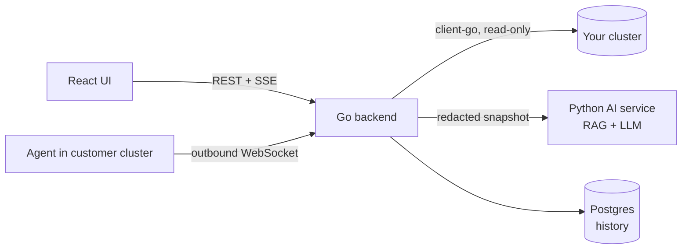

# KubeAssist

**Evidence-grounded Kubernetes troubleshooting.** Pick a broken pod and get a diagnosis: what failed, why, and step-by-step fixes with the exact `kubectl` commands — backed by evidence from your cluster and citations from the Kubernetes docs.

KubeAssist is **read-only**. It never executes anything against a cluster; you copy the commands and run them yourself. Commands that would change the cluster are flagged.

> **Evidence first, docs second, LLM explains.** Go collects evidence and classifies the failure deterministically. The LLM never classifies — it only explains and writes remediation grounded in that evidence and in retrieved docs, and its output is validated before you see it. Without an LLM key it still works, returning curated playbook answers.

## How it works



1. **Collect** (Go): pod, containers, init containers, conditions, events (newest 30), logs from the *failing* container (current + previous, 200 lines / 32 KB), owner chain.
2. **Detect** (Go): 12 failure types, in priority order — `Evicted`, `InitContainerFailure`, `ImagePullBackOff`, `OOMKilled`, `VolumeMountFailure`, `CreateContainerConfigError`, `FailedScheduling`, `ProbeFailure`, `CrashLoopBackOff`, `ReadinessFailure`, `ServiceSelectorMismatch`, plus `Healthy`/`Unknown`.
3. **Pass 2** (Go, only when useful): Services + EndpointSlices and referenced ConfigMap *key names* (never values; Secrets are never read).
4. **Redact** (Go): bearer tokens, passwords, API keys, JWTs, PEM blocks, AWS/GitHub/Slack keys, credentials in URLs — before anything leaves Go (or the customer's cluster).
5. **Explain** (Python): retrieve relevant doc sections, prompt the LLM, then validate: failure type pinned to Go's, citations must come from retrieval, evidence bullets must be traceable to the snapshot, cluster-changing commands are force-flagged. Anything that fails validation falls back to a playbook answer with a caveat.
6. **Save** (Go): snapshot + diagnosis to Postgres, scoped to the cluster.

## Quick start (Docker + Kind)

Requirements: Docker, [Kind](https://kind.sigs.k8s.io/), `kubectl`, `make`.

```bash
make kind        # create the kubeassist-dev Kind cluster (skip if you have one)
make lab         # deploy 11 intentionally broken workloads to kubeassist-lab
make up-kind     # build & start postgres, AI service, backend, UI
```

Open **http://localhost:3000**, pick a pod in `kubeassist-lab`, click **Diagnose**.

To try the multi-tenant agent flow against the same Kind cluster:

```bash
make agent-kind  # builds the agent, loads it into Kind, registers "kind-dev", deploys it
```

Then add `kind-dev` with the printed token under **Connect cluster**. Or register a cluster from the UI, which hands you a ready-to-apply agent manifest.

**Use a real LLM:** copy `.env.example` to `.env`, set `LLM_MOCK=false` and `LLM_API_KEY` (any OpenAI-compatible endpoint: OpenAI, OpenRouter, Groq, Azure, vLLM, or a keyless local Ollama with `LLM_REQUIRE_KEY=false`), then `make up-kind` again.

### Developing on the host

```bash
docker compose up -d postgres ai-service   # dependencies
make dev-backend                           # Go on :8080, uses your kubeconfig
make dev-web                               # Vite on :5173, proxies /api
make test                                  # Go + Python + frontend suites
```

## Repository layout

| Path | What |
| --- | --- |
| [`backend-go/`](backend-go/) | Go API: collector, detectors, redaction, AI client, Postgres store, relay hub, agent (`cmd/agent`) |
| [`ai-service/`](ai-service/) | Python FastAPI RAG service: retrieval over a curated docs corpus, LLM call, validator, confidence |
| [`frontend/`](frontend/) | React UI: Dashboard, Pod Detail, Diagnose (live stages), History, Connect Cluster |
| [`schemas/`](schemas/) | The wire contract (JSON Schema 1.1.0). Both Go (contract tests) and Python (runtime) validate against it |
| [`deploy/`](deploy/) | Lab scenarios, read-only RBAC, Kind agent manifest |
| [`docs/`](docs/) | [API reference](docs/API.md), [deployment guide](docs/DEPLOYMENT.md), AI-service design notes |

## Configuration

Go backend (environment variables):

| Variable | Default | Purpose |
| --- | --- | --- |
| `PORT` | `8080` | HTTP port |
| `ENABLE_LOCAL_MODE` | `true` | Expose the backend's own cluster. **Set `false` for a public deployment** — those routes then don't exist. |
| `KUBECONFIG`, `KUBE_CONTEXT` | — | Local-mode cluster; empty `KUBECONFIG` means in-cluster ServiceAccount |
| `AI_BASE_URL`, `AI_AUTH_TOKEN` | `http://localhost:8000`, — | AI service; without a token the backend runs detector-only |
| `DATABASE_URL` | — | Postgres for history and cluster registrations |
| `ENABLE_RELAY` | `false` | Remote clusters via the agent |
| `RELAY_PUBLIC_URL` | `ws://localhost:8080/agent/connect` | What agents dial (`wss://` in production) |
| `AGENT_IMAGE` | `ghcr.io/yashmit-k/kubeassist-agent:latest` | Image in generated agent manifests |
| `AGENT_TOKENS` | — | Pre-seeded `id:token,id2:token2` registrations |
| `ADMIN_TOKEN` | — | Lets an operator list all clusters |
| `CORS_ALLOWED_ORIGINS` | `http://localhost:5173,http://localhost:3000` | Browser origins when the UI is on another origin |
| `K8S_TIMEOUT`, `AI_TIMEOUT`, `TROUBLESHOOT_TIMEOUT`, `DB_CONNECT_TIMEOUT` | `10s`, `90s`, `120s`, `30s` | Timeouts |

AI service: `AI_SHARED_TOKEN` (must equal the backend's `AI_AUTH_TOKEN`), `LLM_MOCK`, `LLM_API_KEY`, `LLM_BASE_URL`, `LLM_MODEL`, `LLM_TIMEOUT`, `LLM_REQUIRE_KEY`, `RAG_TOP_K`. See [`ai-service/.env.example`](ai-service/.env.example).

## Security model

- **Read-only RBAC** — get/list/watch only; no Secrets; no exec. See [`deploy/rbac`](deploy/rbac/kubeassist-readonly.yaml).
- **Redaction before data leaves Go** — and, for remote clusters, before it leaves the customer's cluster.
- **Commands are never executed.** Mutating commands are detected and flagged regardless of what the model says.
- **Outbound-only agent** — customer clusters accept no inbound traffic; kube credentials never leave them.
- **Per-cluster tokens** on every remote request (constant-time comparison, stored as SHA-256 hashes); history is scoped per cluster.
- **`ENABLE_LOCAL_MODE=false`** removes the operator's own cluster from a public deployment entirely.

## Status

Verified live against Kind (Kubernetes v1.36): every lab scenario classifies correctly — CrashLoopBackOff, OOMKilled, ImagePullBackOff, InitContainerFailure, VolumeMountFailure, CreateContainerConfigError, FailedScheduling, ProbeFailure, ReadinessFailure, ServiceSelectorMismatch and Healthy — both directly (local mode) and through the agent; Postgres history; cluster registrations surviving a backend restart with the agent reconnecting; SSE through nginx. `Evicted` is covered by fixtures only (hard to trigger on demand).

Tested in CI: Go unit, schema-contract, WebSocket tunnel and Postgres integration tests; Python retrieval/pipeline/LLM-path tests (against a mocked OpenAI-compatible server); frontend type-check and tests.

Not yet done: user accounts (registration is open self-serve; clusters are identified only by their tokens), live testing against a hosted LLM in this repo's CI, a Helm chart.

## Deployment

See [docs/DEPLOYMENT.md](docs/DEPLOYMENT.md). In short: backend + AI service on Fly.io/Render/a VPS behind TLS, frontend on Vercel/Netlify/Cloudflare Pages (or the bundled nginx image), Postgres on Neon/Supabase, images from GHCR (published by [`release.yml`](.github/workflows/release.yml) on `v*` tags).

## Credits

Go backend, agent/relay and frontend by [Yashmit Kotekar](https://github.com/Yashmit-k). Python AI service, schemas and lab scenarios by [Vedika](https://github.com/vedikako) — imported with history from [vedikako/kubernetes-assistant](https://github.com/vedikako/kubernetes-assistant); the original integration hub and first UI lived in [vedikako/kubeassist-stack](https://github.com/vedikako/kubeassist-stack). The docs corpus is original summaries that cite the official [kubernetes.io](https://kubernetes.io) pages.
